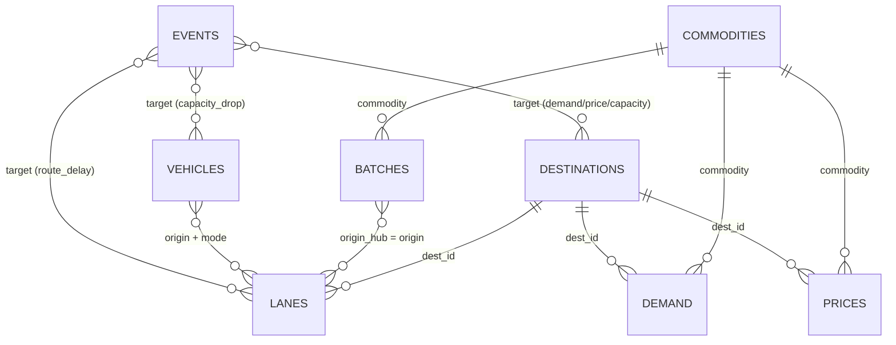

# DATABASE.md

**FreshRoute — data model.** Every table, column, key, unit, rule, and output file the system reads or writes.

> Companion to `ARCHITECTURE.md` (behaviour) and `DECISIONS.md` (decisions).
> **Rule #1: if the organizers publish a cost model or dataset format, theirs overrides this schema.** Fill in §8 (mapping template) and write the adapter (`adapters/organizer.py`, planned, not built); this schema exists so every policy and baseline is scored identically and so we can practise before the real data arrives.
> **Changing any column, file name, or JSON field in this document is a contract change**: update this document in the same change, and bump `schema_version` (data format) or `api_version` (endpoint shape) if a format changed.

---

## 1. Storage approach

- **No database server.** CSV files are the tables; pandas holds them in memory. JSON holds run-level documents.
- Why: reproducible, diffable in git, trivial to swap in hidden scenarios, zero setup on the demo laptop.
- **Source of truth for inputs:** `data/scenarios/<name>/*.csv` + `scenario.json` (or organizer files converted by the adapter).
- **Source of truth for results:** `outputs/<run_id>/` (never edited by hand; the API serves it and the UI only reads it). The API's own bookkeeping lives in `outputs/.api/` and is never a source of truth (D-18, D-21).
- `schema_version` (integer, currently **2**; `config.SCHEMA_VERSION`) is stored in `scenario.json`, `run_manifest.json`, `metrics.json` and `validation.json`. The loader rejects a scenario with a different value. Bump it on any data-format change. Version 2 added `economics_inr.cost_of_goods_sold` (D-28).

---

## 2. Conventions (apply everywhere)

| Topic | Rule |
|---|---|
| Files | UTF-8, comma-separated, header row, `\n` line endings, no index column, no quoting unless needed |
| Time | Hours from the planning epoch `t = 0`; `day(h) = floor(h / 24)`; days are 0-based integers. Epoch = 00:00 of day 0 (assumption A-01) |
| Units | mass **kg** · money **₹** · price **₹/kg** · temperature **°C** · time **h** |
| Percent columns | Columns/fields ending `_pct` hold **0–100** in files and JSON. `data/io.py` converts to fractions (`*_frac`, 0–1) on load — the **only** place that conversion happens |
| Fractions | Fields ending `_frac` hold 0–1 |
| Naming | `snake_case`; suffixes carry units: `_kg`, `_h`, `_inr`, `_inr_kg`, `_c`, `_pct`, `_frac`, `_day` |
| IDs | Non-empty strings, case-sensitive, no spaces recommended; PKs unique within their table |
| Booleans | `true` / `false` in JSON; `True`/`False` or `1`/`0` accepted in CSV on load, written as `true`/`false` |
| Missing values | Not allowed in required columns (load error). Optional columns are blank |
| Floats | Written with enough precision to round-trip (`repr`); money rounded only for display |
| Quantiles | Where a table has `p10/p50/p90`, they must satisfy `p10 ≤ p50 ≤ p90` |
| Prices from Agmarknet | Modal/min/max are ₹ per **quintal**; **÷ 100 → ₹/kg** (1 quintal = 100 kg) |

---

## 3. Input tables

### 3.1 `commodities` — PK `commodity`

| Column | Type | Unit | Rule | Notes |
|---|---|---|---|---|
| `commodity` | str | – | PK, lower_snake | e.g. `tomato` |
| `perishability_class` | enum | – | `very_high` / `high` / `low` | FAO-style tiers |
| `base_shelf_life_h` | float | h | > 0 | Ambient, **de-rated** team assumption (A-15); generator uses it to draw batch RSLs |
| `ref_temp_c` | float | °C | – | Temperature at which 1 h consumes 1 h of life |
| `q10` | float | – | > 0 (typically ≥ 1) | Decay multiplier per +10 °C; default 2 |
| `min_sell_window_h` | float | h | ≥ 0 | Minimum usable life required at arrival |
| `handling_loss_pct` | float | % | 0–100 | Share of delivered kg lost in transit/handling |
| `unit_cost_inr_kg` | float | ₹/kg | ≥ 0 | Procurement/landed cost: charged as cost of goods sold on sold kg and inside the spoilage cost on spoiled kg (A-48) |
| `disposal_cost_inr_kg` | float | ₹/kg | ≥ 0 | |
| `salvage_value_inr_kg` | float | ₹/kg | ≥ 0 | Recovered value of spoiled kg; also the markdown price floor |
| `price_elasticity` | float | uplift per unit discount fraction | ≥ 0 | ε: `effective_demand = demand·(1 + min(ε·discount, MAX_UPLIFT))` |
| `max_discount_pct` | float | % | 0–100 | Per-commodity markdown cap |

Practice-data starting points (generator v3, `generator._COMM`; team assumptions): commodity mix **tomato, spinach, banana, mango, onion, potato** to span FAO's perishability classes — `very_high` (spinach, tomato), `high` (banana, mango), `low` (onion, potato). Base shelf life: spinach 48 h, tomato 144 h, mango 144 h, banana 168 h, onion 1,440 h, potato 1,680 h, so expiry binds for the first four inside a 2–3 day horizon and not for onion or potato. These are team figures, not measured Indian ambient-chain data.

### 3.2 `batches` — PK `batch_id`

| Column | Type | Unit | Rule | Notes |
|---|---|---|---|---|
| `batch_id` | str | – | PK | |
| `commodity` | str | – | FK → `commodities.commodity` | |
| `origin_hub` | str | – | must appear in `lanes.origin` (else warning) | |
| `qty_kg` | float | kg | > 0 | |
| `remaining_shelf_life_h` | float | h | ≥ 0 | **P50** RSL at `available_from_h`, in reference-temperature-equivalent hours (A-03). `0` allowed (edge case: already expired) |
| `rsl_p10_h` | float | h | ≥ 0, `≤ remaining_shelf_life_h` | Used by stress test |
| `rsl_p90_h` | float | h | `≥ remaining_shelf_life_h` | Used by stress test |
| `storage_temp_c` | float | °C | – | Origin storage temperature (decay while waiting) |
| `quality_grade` | str | – | optional | Informational only unless the organizers define a use |
| `available_from_h` | float | h | ≥ 0 | |

### 3.3 `destinations` — PK `dest_id`

| Column | Type | Unit | Rule | Notes |
|---|---|---|---|---|
| `dest_id` | str | – | PK | |
| `name` | str | – | non-empty | Display name |
| `type` | enum | – | `mandi` / `retail_DC` / `HoReCa` / `processor` | |
| `receive_cap_kg_day` | float | kg/day | ≥ 0 | Total receiving capacity per **arrival** day (all commodities) |
| `handling_time_h` | float | h | ≥ 0 | Subtracted from usable life |
| `handling_cost_inr_kg` | float | ₹/kg | ≥ 0 | Applied to delivered kg |
| `window_open_h` | float | h | `< window_close_h` | Meaning depends on `scenario.json: window_mode` (below) |
| `window_close_h` | float | h | | |

`window_mode = absolute`: window is `[open, close]` in hours from epoch. `window_mode = daily`: `open/close` are hours-of-day in `[0, 24]` repeating every day (windows crossing midnight are not supported; split or adapt). Default `absolute` (A-01) — **confirm with the organizers**.

### 3.4 `demand` — PK `(dest_id, commodity, day)`

| Column | Type | Unit | Rule | Notes |
|---|---|---|---|---|
| `dest_id` | str | – | FK → `destinations` | |
| `commodity` | str | – | FK → `commodities` | |
| `day` | int | day | ≥ 0 | |
| `demand_kg_p50` | float | kg | ≥ 0 | Base (undiscounted) demand used for planning and the base realization |
| `demand_kg_p10` | float | kg | ≥ 0, `≤ p50` | |
| `demand_kg_p90` | float | kg | `≥ p50` | |
| `event_flag` | str | – | blank = none | Free-text/`event_id` marker for event-affected days |

A missing `(dest, commodity, day)` row means demand 0 (counted and reported as a warning).

### 3.5 `prices` — PK `(dest_id, commodity, day)`

| Column | Type | Unit | Rule | Notes |
|---|---|---|---|---|
| `dest_id` | str | – | FK | |
| `commodity` | str | – | FK | |
| `day` | int | day | ≥ 0 | |
| `price_inr_kg` | float | ₹/kg | > 0, `price_min ≤ price ≤ price_max` | Modal price (Agmarknet modal ÷ 100 for practice data) |
| `price_min` | float | ₹/kg | > 0 | |
| `price_max` | float | ₹/kg | > 0 | |

Every `(dest, commodity, day)` with `demand_kg_p50 > 0` needs a price. If missing: forward-fill from the previous day for that pair (warning); if no earlier day exists → **load error**.

### 3.6 `lanes` — PK `(origin, dest_id, mode)`

| Column | Type | Unit | Rule | Notes |
|---|---|---|---|---|
| `origin` | str | – | | Origin hub id (matches `batches.origin_hub`, `vehicles.origin`) |
| `dest_id` | str | – | FK → `destinations` | |
| `mode` | enum | – | `reefer` / `ambient` / `rail` | |
| `travel_h_p50` | float | h | > 0 | Used for planning |
| `travel_h_p90` | float | h | `≥ travel_h_p50` | Used by stress test |
| `cost_fixed_inr_trip` | float | ₹/trip | ≥ 0 | |
| `cost_var_inr_kg` | float | ₹/kg | ≥ 0 | |
| `transit_temp_c` | float | °C | – | Drives transit decay |
| `departure_slots` | str | hour-of-day | `rail` only: pipe-separated hours in `[0, 24)`, e.g. `18\|22`; blank otherwise | Rail is a slower, cheaper lane with fixed departure slots |

### 3.7 `vehicles` — PK `vehicle_id`

| Column | Type | Unit | Rule | Notes |
|---|---|---|---|---|
| `vehicle_id` | str | – | PK | One physical vehicle |
| `origin` | str | – | | |
| `mode` | enum | – | `reefer` / `ambient` / `rail` | Must match a lane mode from the same origin (else warning) |
| `capacity_kg` | float | kg | > 0 | |
| `available_from_h` | float | h | ≥ 0 | |
| `max_trips_day` | int | trips/day | ≥ 0 | `0` allowed (edge case: zero capacity) |

### 3.8 `events` — PK `event_id` (hidden-scenario practice; schema in §6)

| Column | Type | Rule |
|---|---|---|
| `event_id` | str | PK |
| `type` | enum | `route_delay` / `capacity_drop` / `demand_spike` / `new_order` / `price_shock` |
| `target` | str | syntax per type (§6) |
| `magnitude` | float | range per type (§6) |
| `at_h` | float | ≥ 0 |

### 3.9 `geo` — optional, **UI only** (PK `node_id`)

Our addition for the shelf-life countdown map. The optimizer never reads it. If absent, the UI falls back to a colour-coded table. The map reads it through `GET /api/scenarios/{name}/geo` (§11).

| Column | Type | Rule |
|---|---|---|
| `node_id` | str | PK; a hub id or a `dest_id` |
| `node_type` | enum | `hub` / `destination` |
| `name` | str | |
| `lat` | float | −90…90 |
| `lon` | float | −180…180 |

### 3.10 `scenario.json`

```json
{
  "schema_version": 2,
  "name": "practice",
  "source": "synthetic",
  "seed": 42,
  "horizon_days": 3,
  "window_mode": "daily",
  "dispatch_hour": 5,
  "price_source": "static_table_generator_v3",
  "notes": "free text"
}
```
`source` is `synthetic` or `organizer`. `price_source` is optional and informational (e.g. `static_table_generator_v3` or a future `agmarknet_snapshot`); the loader ignores it. `dispatch_hour` overrides `config.DISPATCH_HOUR`. `horizon_days` bounds `demand.day`, `prices.day`, dispatch days and arrival days.

---

## 4. Derived tables (in memory; written to `outputs/` when useful)

### 4.1 `arcs` — one row per candidate `(batch, dest, vehicle, dispatch day)` (built by `domain/feasibility.py`)

| Column | Type | Notes |
|---|---|---|
| `batch_id`, `dest_id`, `vehicle_id` | str | |
| `mode` | enum | lane/vehicle mode |
| `dispatch_day` | int | `t` |
| `dispatch_h` | float | `max(24t + DISPATCH_HOUR, available_from_h(batch), available_from_h(vehicle))`, moved to the next slot for rail |
| `arrival_h`, `arrival_day` | float, int | `dispatch_h + travel_h_p50` |
| `usable_life_at_arrival_h` | float | ARCHITECTURE §7 |
| `slack_h` | float | `usable_life_at_arrival_h − min_sell_window_h` (negative ⇒ infeasible by shelf life) |
| `price_inr_kg` | float | price at `(dest, commodity, arrival_day)` |
| `margin_inr_kg` | float | `costmodel.shipped_margin`: `(p − unit_cost)·(1 − h_c) − cost_var − handling_cost_inr_kg` (before fixed trip cost) |
| `feasible` | bool | |
| `reject_reason` | enum | blank if feasible; else `NO_LANE`, `NOT_AVAILABLE`, `RAIL_SLOT`, `WINDOW`, `SHELF_LIFE`, `BEYOND_HORIZON` (first failing check in that order) |

Rejected rows are kept: reason cards read them.

### 4.2 `demand_target` — one row per `(dest_id, commodity, day)` (newsvendor)

`dest_id, commodity, day, target_kg, quantile_used, c_u, c_o`. When the newsvendor flag is off, `target_kg = demand_kg_p50` (`quantile_used = 0.5`). Built by `newsvendor.demand_target` (ARCHITECTURE §14.3); written as `outputs/<run_id>/demand_target.csv` only for `--newsvendor` runs, sorted by key. `c_u ≤ 0` ⇒ `target_kg = 0`, `quantile_used = 0`. A row with no priced lane from an origin holding the commodity keeps `target_kg = demand_kg_p50`, `quantile_used = 0.5`, `c_u = c_o = NaN` (no arc can use it). `--newsvendor` is accepted only for `milp`.

---

## 5. Output files (`outputs/<run_id>/`)

`run_id` = `<scenario>__<policy>__s<seed>[__nv]` — the `__nv` suffix is added only when `--newsvendor` is on (stable and human-readable; no timestamps in the id).

### 5.1 `run_manifest.json`

```json
{
  "schema_version": 2,
  "run_id": "practice__milp__s42",
  "git_sha": "…",
  "scenario": "data/scenarios/practice",
  "scenario_sha256": "…",
  "policy": "milp",
  "flags": {"markdown": false, "newsvendor": false},
  "seed": 42,
  "realization": "base",
  "package_versions": {"python": "…", "scipy": "…", "pulp": "…", "highspy": "…", "pandas": "…"},
  "solver": {"status": "optimal", "mip_gap": 0.0, "solve_seconds": 0.0, "fallback_used": false, "slack_usage": {}},
  "timestamp_utc": "…"
}
```
`flags.newsvendor` is `true` only for `--newsvendor` runs (then `run_id` ends in `__nv`). `flags.markdown` is `true` only when the run wrote discount rows (the `last_day_50` baseline). `solver` is `null` for non-MILP policies. While a show-while-solving run is still improving (ARCHITECTURE §16.2), the manifest holds `solver: {"status": "incumbent", "final": false}`; the finished run carries the full block above. MILP runs also carry `size` (`{"vars", "constraints"}` of the model solved) and, only when the scale model ran (ARCHITECTURE §9.5), `aggregation` (`{"batches", "groups", "vehicle_classes", "agg_arcs", "dropped_lines", "unassigned_kg", "validator_violations"}`). Timestamp and `solve_seconds` are the only fields allowed to differ between identical runs.

### 5.2 `plan.csv` — PK `shipment_id` (one row per batch × destination × trip line)

| Column | Type | Notes |
|---|---|---|
| `shipment_id` | str | e.g. `S0001` |
| `batch_id`, `dest_id`, `vehicle_id` | str | |
| `trip_id` | str | FK → `trips.trip_id` |
| `mode` | enum | |
| `dispatch_day` | int | |
| `dispatch_h`, `arrival_h` | float | |
| `arrival_day` | int | |
| `kg` | float | > 0 |
| `usable_life_at_arrival_h` | float | |
| `slack_h` | float | |
| `margin_inr_kg` | float | |
| `priority_rank` | int | 1 = dispatch first |
| `priority_score` | float | `(1 / usable_life_at_arrival_h) · (kg · price)` |
| `is_frozen` | bool | `true` only in replanned plans (already dispatched at `at_h`) |
| `policy` | str | which policy produced the row |

### 5.3 `trips.csv` — PK `trip_id`

`trip_id` (`T-<vehicle>-<dest>-<day>-<k>`), `vehicle_id`, `origin`, `dest_id`, `mode`, `dispatch_day`, `dispatch_h`, `kg_total`, `capacity_kg`, `utilization_pct`, `cost_fixed_inr`, `cost_var_inr`.
Loads are assigned to trips by deterministic first-fit in priority order; one batch line may split across trips. `Σ_trip kg_total ≤ capacity_kg`.

### 5.4 `discounts.csv` — PK `(lot_id, day)`

| Column | Type | Notes |
|---|---|---|
| `lot_id` | str | `<batch_id>@<dest_id>@<arrival_day>` |
| `dest_id`, `commodity`, `batch_id` | str | |
| `day` | int | |
| `stock_kg` | float | stock the risk was computed on |
| `risk` | float | 0–1 |
| `tier_base_pct` | float | tier from risk |
| `tier_after_time_trigger_pct` | float | after the ≤ 24 h step-up |
| `discount_pct` | float | final after caps, worth-it test and monotonicity |
| `capped_by` | enum | `none` / `max_discount` / `salvage_floor` |
| `applied` | bool | `false` if the worth-it test removed the discount |
| `forced_by_monotone` | bool | |
| `delta_revenue_inr` | float | the worth-it test value |

### 5.5 Unshipped stock

Not written as a file. Unshipped kg and its fate are in `metrics.json`: `volumes_kg.unshipped`, `volumes_kg.carryover.origin` and `spoilage_breakdown_kg.origin_expired` (§5.7).

### 5.6 `sim_ledger.csv` (PK `(dest_id, commodity, day)`) and `sim_lots.csv` (PK `lot_id`)

`sim_ledger.csv`: `dest_id, commodity, day, base_demand_kg, effective_demand_kg, delivered_kg, handling_loss_kg, sold_kg, price_inr_kg, discount_frac, unsold_expired_kg, on_hand_end_kg, carryover_kg`. (`discount_frac` is 0–1 in memory and in this file; money columns are not stored here — `metrics.json` derives revenue from `sold_kg`, `price_inr_kg` and `discount_frac` via `domain/costmodel.py`.)
`sim_lots.csv`: `lot_id, dest_id, commodity, arrival_h, arrival_day, expiry_h, kg_arrived, kg_handling_loss, kg_sold, kg_expired_unsold, kg_carryover`.

### 5.7 `metrics.json`

Structure (values here are placeholders):

```json
{
  "schema_version": 2,
  "run_id": "…", "scenario": "…", "policy": "…", "seed": 42, "realization": "base",
  "kpis": {
    "spoilage_kg": 0.0, "spoilage_pct": 0.0,
    "demand_fulfillment_pct": 0.0, "min_dest_fill_pct": 0.0,
    "net_inr": 0.0, "violations": 0
  },
  "spoilage_breakdown_kg": {"handling_loss": 0.0, "delivered_unsold_expired": 0.0, "origin_expired": 0.0},
  "economics_inr": {
    "gross_revenue_at_list": 0.0, "discount_cost": 0.0, "revenue": 0.0,
    "cost_of_goods_sold": 0.0, "transport": 0.0, "handling": 0.0, "spoilage_cost": 0.0, "net": 0.0
  },
  "volumes_kg": {
    "total_supply": 0.0, "shipped": 0.0, "unshipped": 0.0, "sold": 0.0,
    "carryover": {"destination": 0.0, "origin": 0.0, "total": 0.0}
  },
  "trips": {"count": 0, "avg_utilization_pct": 0.0},
  "per_destination": [{"dest_id": "…", "fill_pct": 0.0, "sold_kg": 0.0, "spoiled_kg": 0.0}],
  "per_commodity": [{"commodity": "…", "spoilage_kg": 0.0, "spoilage_pct": 0.0, "sold_kg": 0.0}]
}
```

**Invariants (unit-tested on every policy):**
1. `revenue = gross_revenue_at_list − discount_cost`
2. `net = revenue − cost_of_goods_sold − transport − handling − spoilage_cost`, and `kpis.net_inr == economics_inr.net`
3. `spoilage_kg = handling_loss + delivered_unsold_expired + origin_expired`
4. **Mass balance:** `total_supply = sold + spoilage_kg + carryover.total`
5. `total_supply = shipped + unshipped`
6. `spoilage_pct = spoilage_kg / total_supply × 100`
7. `cost_of_goods_sold = Σ sold_kg × unit_cost_inr_kg` (A-48)

### 5.8 `validation.json`

```json
{
  "schema_version": 2,
  "violation_total": 0,
  "counts": {"SHELF_LIFE": 0},
  "violations": [{"code": "SHELF_LIFE", "shipment_id": "S0007", "detail": "…", "observed": 13.0, "limit": 24.0}],
  "warnings": [{"code": "DEMAND_CAP_EXCEEDED", "detail": "…"}]
}
```
Violation and warning code lists: ARCHITECTURE §11. `kpis.violations == violation_total`.

### 5.9 `reason_cards.json` — list, one card per `shipment_id`

```json
{
  "shipment_id": "S0007", "batch_id": "B014", "commodity": "tomato",
  "chosen": {"dest_id": "PUNE", "vehicle_id": "V03", "mode": "reefer", "dispatch_h": 5.0, "arrival_h": 17.0,
             "kg": 420.0, "usable_life_at_arrival_h": 41.0, "slack_h": 17.0, "margin_inr_kg": 0.0},
  "priority": {"rank": 3, "score": 0.0},
  "alternatives": [{"dest_id": "DELHI", "mode": "ambient", "dispatch_day": 0, "feasible": false,
                    "reject_reason": "SHELF_LIFE", "usable_life_at_arrival_h": 9.0, "slack_h": -15.0,
                    "margin_inr_kg": 0.0, "margin_delta_inr_kg": 0.0, "slack_delta_h": 32.0,
                    "reason_code": "SHELF_LIFE"}],
  "runner_up": {"dest_id": "DELHI", "reason_code": "SHELF_LIFE", "margin_delta_inr_kg": 0.0,
                "margin_delta_inr": 0.0, "slack_delta_h": 32.0},
  "discount": {"day": 2, "risk": 0.38, "tier_pct": 20, "capped_by": "none"},
  "text": "Sent to Pune, not Delhi: …"
}
```
Written by `runs.runner.run` for every run (`engine.reasons.build_cards`); a list sorted by `shipment_id`, one card per `plan.csv` row. All numbers are copied from `plan.csv`, the feasibility arcs (§4.1) and `discounts.csv`; nothing is re-optimised. Implementation (no format change): arcs are built scoped to batches in the plan × all destinations × one vehicle per `(origin, mode, available_from_h)` class (A-44/A-46); callers holding arcs may pass them as `build_cards(..., arcs=...)`. `chosen` is the plan row. `alternatives` holds, for every other destination × mode of the same batch, its best arc (feasible first, then highest `margin_inr_kg`, `slack_h`, earliest day, `vehicle_id`); arcs rejected as `NO_LANE`/`NOT_AVAILABLE` are not alternatives. Sorted feasible first, then margin descending; `alternatives[0]` is the runner-up, summarised in `runner_up` (`null` when there is no alternative).

`alternatives[].reason_code ∈ {SHELF_LIFE, WINDOW, CAPACITY_BOUND, DEMAND_CAP, LOWER_MARGIN}`: an infeasible arc maps its `reject_reason` (`SHELF_LIFE`→`SHELF_LIFE`, `WINDOW`/`BEYOND_HORIZON`→`WINDOW`, `RAIL_SLOT`→`CAPACITY_BOUND`); a feasible arc is `LOWER_MARGIN` if its margin is below the chosen one, else `DEMAND_CAP` if the plan already ships ≥ `demand_kg_p50` to that destination × commodity × arrival day, else `CAPACITY_BOUND`. Deltas are **chosen − alternative**: `margin_delta_inr_kg` (₹/kg), `margin_delta_inr` = that × `chosen.kg` (₹), `slack_delta_h` (h). A positive margin delta means the chosen option earns more; a negative one only occurs with `DEMAND_CAP`/`CAPACITY_BOUND`. `discount` is the first applied, non-zero `discounts.csv` row of the shipment's lot (`tier_pct` = its `discount_pct`), `null` when none applies. Numbers above are format examples only.

### 5.10 Dispatch sheet — `dispatch_sheet.csv` and `dispatch_sheet.txt`

CSV columns: `vehicle_id, trip_id, dispatch_h, depart_clock, dest_id, dest_name, batch_id, commodity, kg, priority_rank, slack_h, arrive_by_h, note`. Rows ordered by `priority_rank`.
Text (one block per trip, WhatsApp-style, plain text):

```
Vehicle V03 | Trip T-V03-PUNE-0-1 | Depart 05:00 (day 0)
To: Pune DC
Load: B014 tomato 420 kg (slack 17 h) | B009 tomato 180 kg (slack 22 h)
Arrive by: day 0 17:00
```

### 5.11 `ladder.json` and `waterfall.json`

`ladder.json`:
```json
{"scenario": "…", "seed": 42, "realization": "base",
 "official_baseline": null,
 "ladder": [{"policy": "fifo", "kpis": {}}, {"policy": "fefo", "kpis": {}},
            {"policy": "milp", "kpis": {}}],
 "extras": [{"policy": "last_day_50", "kpis": {}}],
 "ablation": [{"policy": "milp", "flags": {"newsvendor": true},
               "run_id": "…__milp__s42__nv", "vs": "milp", "kpis": {},
               "delta": {"net_inr": 0.0, "spoilage_kg": 0.0, "spoilage_pct": 0.0,
                         "demand_fulfillment_pct": 0.0}}]}
```
`kpis` has the same keys as `metrics.json → kpis`. `ablation` is present only for `freshroute ladder --newsvendor` (absent otherwise, so the flag-off file is unchanged): the plan policy re-run with the §14.3 target, scored by the same simulator, its run dir written beside the others; `delta` = ablation KPI − `vs`.

`waterfall.json`:
```json
{"baseline": "fefo", "plan": "milp", "tolerance_inr": 0.01,
 "steps": [
  {"label": "Baseline net", "value": 0.0, "type": "total"},
  {"label": "Spoilage cost avoided", "value": 0.0, "type": "delta"},
  {"label": "Extra sales (list price)", "value": 0.0, "type": "delta"},
  {"label": "Cost of extra goods sold", "value": 0.0, "type": "delta"},
  {"label": "Extra transport", "value": 0.0, "type": "delta"},
  {"label": "Extra handling", "value": 0.0, "type": "delta"},
  {"label": "Discounts given", "value": 0.0, "type": "delta"},
  {"label": "FreshRoute net", "value": 0.0, "type": "total"}]}
```
Step formulas: `ARCHITECTURE.md` §12. Signs: cost steps are negative when the plan spends more. Invariant: `first total + Σ deltas = last total` within tolerance.

**While there is no organizer baseline (`organizer_baseline` is planned, not built):** `ladder.json → official_baseline` is `null` and `waterfall.json → baseline` is `"fefo"`. Both would switch to `organizer_baseline` once it is implemented. Written by `freshroute ladder` to `outputs/<scenario>__ladder__s<seed>/`; each ladder policy also gets its normal `outputs/<run_id>/`.

### 5.12 Stress and sensitivity

- `stress.csv` — one row per scenario `i` per policy: `scenario_i, policy, spoilage_kg, spoilage_pct, demand_fulfillment_pct, min_dest_fill_pct, net_inr`.
- `stress_summary.json`:
```json
{"n": 200, "base_seed": 42, "plan": "milp", "baseline": "fefo",
 "bands": {"net_inr": {"plan": {"p10": 0, "p50": 0, "p90": 0}, "baseline": {"p10": 0, "p50": 0, "p90": 0}},
           "spoilage_kg": {"plan": {}, "baseline": {}},
           "demand_fulfillment_pct": {"plan": {}, "baseline": {}}},
 "share_plan_beats_baseline": {"net_inr": 0.0, "spoilage_kg": 0.0}}
```
`share_plan_beats_baseline` is in 0–1 over **paired** scenarios. Bands are `numpy.percentile` (linear) over the `n` scenarios; `baseline` is `fefo` while there is no organizer baseline. With `--named`, `n = 3` and `scenario_i` 0/1/2 = optimistic/base/stress (`MC_NAMED`, A-42). Written by `freshroute stress` to `outputs/<scenario>__stress__s<seed>/`.
- `sensitivity.csv` — `parameter, value, policy, net_inr, spoilage_kg, demand_fulfillment_pct`. Parameters: `q10` (1.5, 2.0, 3.0; overrides every commodity's `q10`), `elasticity_multiplier` (1, 0.5; scales `price_elasticity`), `overship_slack` (0, 0.05, 0.10), `demand_multiplier` (0.8, 1.0, 1.2; scales p10/p50/p90). One row per (parameter, value), one parameter moved at a time, `policy` = `milp`; rows at the base value (`elasticity_multiplier` 1, `overship_slack` = `OVERSHIP_SLACK`, `demand_multiplier` 1.0) are the plain run. Values from `config.py` `SENS_*`. Written by `freshroute sensitivity` to `outputs/<scenario>__sensitivity__s<seed>/`.

### 5.13 Replan outputs — `replan/<event_id>/`

- `event.json` (§6) · `plan.csv`, `trips.csv`, `discounts.csv`, `metrics.json`, `validation.json` (same formats as above; `plan.csv` has `is_frozen`).
- `diff.json`:
```json
{"event_id": "E-001", "at_h": 8.0,
 "frozen_shipments": 0, "moved_batches": [{"batch_id": "B014", "from": {"dest_id": "DELHI", "dispatch_day": 0},
                                           "to": {"dest_id": "PUNE", "dispatch_day": 0}, "kg": 0.0}],
 "discount_changes": [{"lot_id": "…", "day": 2, "from_pct": 10, "to_pct": 20}],
 "kpis_old_plan_under_event": {}, "kpis_replanned": {}, "delta_kpis": {},
 "solve_seconds": 0.0}
```
`kpis_old_plan_under_event` = the old plan executed in the changed world (the honest do-nothing comparison).

Written by `freshroute replan` (`runs/replan.py`). Field rules:
- `kpis_old_plan_under_event`, `kpis_replanned`: the six `metrics.json` `kpis` (`spoilage_kg`, `spoilage_pct`, `demand_fulfillment_pct`, `min_dest_fill_pct`, `net_inr`, `violations`), both from the one simulator on the changed world; `delta_kpis` = replanned − old, per key. `violations` counts as in `validation.json` below.
- `moved_batches`: per batch, the `(dest_id, dispatch_day)` carrying most of its **undispatched** kg in the old plan vs the replan, listed only when they differ; `kg` = kg on the new main line (on the old one if the batch is now unshipped). `dest_id`/`dispatch_day` are `null` on the side where the batch is unshipped.
- `discount_changes`: every `(lot_id, day)` whose `discount_pct` differs (a missing row counts as 0); `from_pct`/`to_pct` are floats.
- `solver`: `{"status", "mip_gap", "fallback_used"}` of the residual MILP (as in `run_manifest.json`), `null` when nothing was left to plan.
- `solve_seconds`: wall time from applying the event to the finished plan and discounts. It is the only field allowed to differ between identical replans.

`plan.csv`: frozen rows first (`is_frozen = true`, every decision column — ids, `trip_id`, `mode`, dispatch, `kg`, `margin_inr_kg`, priority — copied from the old plan; a `route_delay` re-times `arrival_h`, `arrival_day`, `usable_life_at_arrival_h`, `slack_h` of rows still travelling at `at_h`), then the replanned rows: `shipment_id` continues after the old plan's highest id, `priority_rank` after the frozen ones, and a trip id that would collide with a frozen trip on the same vehicle/destination/day takes the next free number. A shipment already marked `is_frozen` stays frozen in a later replan. `trips.csv`: frozen trips (kg re-summed if a trip was only partly frozen) plus the new ones.

`validation.json`: the independent validator on the whole plan in the changed world. A violation the frozen rows already cause on their own (an in-transit delay breaking shelf life, a trip that left before a `capacity_drop` loaded above the new capacity) cannot be replanned away: it is moved to `warnings` with code `FROZEN_<code>` (same fields as a violation) and is not counted in `violation_total` (A-43). The same rule applies to the old plan's `violations` in the diff.

Chaining: `--run` may be a replan directory; its world is its parent run's scenario with each `event.json` on the path applied in order, so the second replan lands in `<run>/replan/<e1>/replan/<e2>/` (chaining needs this default layout).

### 5.14 Directory layouts

```
data/scenarios/<name>/        commodities.csv batches.csv destinations.csv demand.csv prices.csv
                              lanes.csv vehicles.csv events.csv geo.csv scenario.json
outputs/<run_id>/             run_manifest.json plan.csv trips.csv discounts.csv
                              sim_ledger.csv sim_lots.csv metrics.json validation.json
                              reason_cards.json dispatch_sheet.csv dispatch_sheet.txt
                              [demand_target.csv — --newsvendor runs only]
                              [replan/<event_id>/…]
outputs/<scenario>__ladder__s<seed>/       ladder.json waterfall.json (§5.11)
outputs/<scenario>__stress__s<seed>/       stress.csv stress_summary.json (§5.12)
outputs/<scenario>__sensitivity__s<seed>/  sensitivity.csv (§5.12)
outputs/.api/jobs/              API run-queue state only (§11); gitignored with the rest of outputs/
outputs/demo_backup/            committed copy of the demo outputs (practice, seed 42): the fifo, fefo, last_day_50 and
                                milp runs, plus the ladder, stress and sensitivity directories (fallback if the solver fails on demo day)
```

The HTTP layer has its own `api_version` (§11).

---

## 6. Event schema (replan and the optional LLM parser)

```json
{"event_id": "E-001", "type": "route_delay", "target": "NASHIK|PUNE|*", "magnitude": 6, "at_h": 8, "note": "NH-48 jam"}
```
Validated with pydantic (`data/events.py`: `Event`, `load_event`, `apply_event`). `note` is optional and never used by the solver. Unknown fields, an unknown `type`, a malformed `target` or a `magnitude` out of range are rejected at parse time; a `target` naming a lane, vehicle, destination or commodity the scenario does not have raises `EventError` when the event is applied. `day(at_h) = ⌊at_h / 24⌋`. A `new_order` for a `(dest, commodity, day)` with no demand row creates one (p10 = p50 = p90 = `magnitude`, `event_flag` = `event_id`). **Semantics are our interpretation (A-14) — confirm against the organizers' event definitions.**

| `type` | `target` syntax | `magnitude` | Effect |
|---|---|---|---|
| `route_delay` | lane key `origin\|dest_id\|mode`; `*` allowed in any position | hours ≥ 0 | Adds `magnitude` to `travel_h_p50` and `travel_h_p90` of matching lanes; affects not-yet-dispatched **and** in-transit trips whose `arrival_h > at_h` |
| `capacity_drop` | `vehicle:<vehicle_id>` or `dest:<dest_id>` | fraction lost, 0–1 | Multiplies `capacity_kg` (vehicle) or `receive_cap_kg_day` (destination) by `1 − magnitude` from `at_h` |
| `demand_spike` | `dest:<dest_id>\|<commodity>`; `*` allowed for commodity | multiplier > 0 | Multiplies p10/p50/p90 demand for days `≥ day(at_h)` |
| `new_order` | `dest:<dest_id>\|<commodity>` | extra kg ≥ 0 | Adds `magnitude` kg to p10/p50/p90 demand on `day(at_h)` |
| `price_shock` | `dest:<dest_id>\|<commodity>`; `*` allowed for commodity | multiplier > 0 | Multiplies `price_inr_kg/min/max` for days `≥ day(at_h)` |

Freeze rule: a shipment is frozen iff `dispatch_h ≤ at_h`. Frozen shipments consume stock, trips, receiving capacity and demand, but cannot be reassigned.

Canned events for the dropdown (one per type; adjust ids to the scenario): NH-48 jam (`route_delay`, +6 h on all lanes into one destination), a reefer breakdown (`capacity_drop` 0.5 on one reefer), a demand spike ×1.5 at one destination for one commodity, a `new_order` of a few hundred kg, and a `price_shock` ×0.8.

---

## 7. Load-time integrity checks (`io.load_scenario`)

**Errors (stop):** missing table or required column; NaN/blank in a required field; duplicate PK; unknown enum value; FK violation (`batches.commodity`, `demand`/`prices` `dest_id` and `commodity`, `lanes.dest_id`); numeric range violations (§3); quantile ordering violation (`p10 ≤ p50 ≤ p90`, `travel p50 ≤ p90`, RSL ordering); `window_open_h ≥ window_close_h`; `rail` lane without `departure_slots`; `demand.day` or `prices.day` negative; a price needed for `demand_kg_p50 > 0` but none available even after forward-fill.

**Warnings (continue, count and print):** batch `origin_hub` with no lane; vehicle `(origin, mode)` with no matching lane; non-rail lane with `departure_slots`; missing demand rows (treated as 0); forward-filled prices; `salvage_value_inr_kg > unit_cost_inr_kg + disposal_cost_inr_kg` (negative spoilage cost); `max_discount_pct > 0` with `price_elasticity = 0`; `available_from_h ≥ 24 · horizon_days`; `demand.day ≥ horizon_days`; `scenario.source = synthetic` (printed on every scoreboard so synthetic numbers are never mistaken for real ones).

**Conversions (once, here):** `handling_loss_pct → handling_loss_frac`, `max_discount_pct → max_discount_frac`. Tests: 2.5 in CSV ⇒ 0.025 in memory ⇒ 2.5 back in outputs.

---

## 8. Organizer mapping template (to fill when the organizers publish their data)

Complete this table from the organizers' material. "Status": `OK` mapped · `XFORM` needs a transform · `MISSING` no equivalent (decide + log an assumption) · `N/A`.

| Our table.column | Organizer file.column | Transform | Status |
|---|---|---|---|
| `batches.*` (qty, RSL, temp, availability, origin) | | | |
| `commodities.base_shelf_life_h / ref_temp_c / q10` | | | |
| `commodities.min_sell_window_h` | | | |
| `commodities.handling_loss_pct` | | | |
| `commodities.unit_cost / disposal_cost / salvage_value` | | | |
| `commodities.price_elasticity / max_discount_pct` | | | |
| `destinations.receive_cap_kg_day` | | | |
| `destinations.handling_time_h / handling_cost_inr_kg` | | | |
| `destinations.window_open_h / window_close_h` (+ `window_mode`) | | | |
| `demand.demand_kg_p10/p50/p90` | | | |
| `prices.*` | | | |
| `lanes.travel_h_p50/p90` | | | |
| `lanes.cost_fixed_inr_trip / cost_var_inr_kg` | | | |
| `lanes.transit_temp_c` | | | |
| `lanes.departure_slots` (rail) | | | |
| `vehicles.*` (capacity, trips/day, availability) | | | |
| `events.*` | | | |
| Origin handling cost (we assume 0 — A-07) | | | |
| Discount / markdown rules (tiers, caps, elasticity) | | | |
| Spoilage definition and cost | | | |
| Fulfillment definition | | | |
| Hard-constraint list (what counts as a violation) | | | |
| Submission/plan output format (for `organizer_baseline` export) | | | |

---

## 9. Synthetic generator and the Agmarknet snapshot

### 9.1 Generator v3 (`generator.py`)

All committed scenarios under `data/scenarios/` are produced by `freshroute generate [names…] [--out data/scenarios]` (default: every name in `generator.COMMITTED`). Output is byte-deterministic per seed (`numpy.random.default_rng(seed)`). Every `scenario.json` says `source = synthetic` and `price_source = static_table_generator_v3`. Design rationale: D-29; assumptions: A-47, A-49.

- **Network.** Real node names and coordinates (`geo.csv`): hubs `HUB1` (Kolar) and `HUB2` (Chikkaballapur); destinations `D1`–`D8` from `generator.DESTS` (KR Market, Hoskote, Whitefield, Tumakuru, Chennai, Mysuru, Hyderabad, Electronic City). Scenarios with 4 or fewer destinations use `HUB1` only.
- **Lanes.** Road travel time = road km (haversine × 1.3) / 40 km/h + 0.5 h, for both `reefer` and `ambient`; p90 = p50 × U(1.15, 1.40). Rail lanes exist only to destinations at least 200 km away (departure slots `18|22`).
- **Outlets.** Outlet `type` sets the daily delivery window (`window_mode = daily`), price premium over the mandi, commodity basket, handling time and cost, and receiving capacity (headroom over mean daily demand).
- **Demand.** Per commodity, total p50 ≈ U(0.9, 1.1) × that commodity's supply. It is placed only on days some lane with a vehicle can reach the outlet inside its window, so no demand is unreachable. Outlet shares are lognormal and capped at 35 % when at least three outlets take the commodity; the daily multiplier is AR(1) around 1.
- **Prices.** Static modal ₹/kg table per commodity × outlet-type premium × a shared per-commodity daily market walk; `price_min`/`price_max` from per-commodity spreads.
- **Shelf life.** Per-commodity base hours, q10 and reference temperature (`generator._COMM`) chosen so expiry binds for spinach, tomato, banana and mango. Batch RSL = Beta(5, 2) × base; the quality grade (A/B) is derived from that fraction; storage temperature is drawn per commodity.
- **Fleet.** Both road modes at every hub; capacities 1 / 3 / 5 / 9 t; `max_trips_day = floor(16 / (2 × median lane h))`, at least 1; one `rail` vehicle per hub that has a rail lane.
- **Committed scenarios.** `practice` and `small` (seed 42), plus a hidden-style suite (`hidden_small`, `hidden_practice`, `hidden_3x`, `hidden_10x`, five `hidden_ev_*` with one event each, `hidden_edge` with an already-expired batch and a zero-trip vehicle). Practice = seed 42, 200 batches, 8 destinations, 3 days, 6 road vehicles.

### 9.2 Agmarknet snapshot (not available)

- **Source:** "Variety-wise Daily Market Prices Data of Commodity" on data.gov.in (Agmarknet via the OGD platform). Fields: state, district, market, commodity, variety, grade, min/max/modal price (₹ per quintal).
- **Access requires a registered API key.** Resource ids: `35985678-0d79-46b4-9ed6-6f13308a1d24` (current, filters are PascalCase: `filters[Arrival_Date]`, `filters[State]`) and `9ef84268-d588-465a-a308-a864a43d0070` (original, lowercase filters: `filters[arrival_date]`, `filters[state]`). The widely circulated sample key returns `{"error": "Key not authorised"}` — **do not ship one in git.** The key would go in `.env` as `DATAGOV_API_KEY` (git-ignored), paging with `limit=500&offset=…`.
- **Status:** no snapshot exists and `data/agmarknet/` is empty. The generator's static price table stands in for it; its modal levels are re-based on published Agmarknet aggregates (Farmer.in ticker, CEDA series — keyless, not a snapshot). A-20 therefore does not apply to the practice data.
- **Planned, not built:** `scripts/build_prices.py` (the `scripts/` directory is empty) and a cached `data/agmarknet/agmarknet_snapshot.csv` with columns `state, district, market, commodity, variety, arrival_date, min_price, max_price, modal_price` (₹/quintal as published). The transform would be `price_inr_kg = modal_price / 100`, `price_min = min_price / 100`, `price_max = max_price / 100`; map markets to `dest_id` and commodity names by hand; replay the most recent `horizon_days` days as day `0…H−1`.
- Context only: post-harvest-loss statistics (NABCONS/PIB) are used to judge whether the synthetic baseline is plausible (A-47), never as model inputs presented as real batch data.

---

## 10. Relationships



Text form: `batches.commodity → commodities` · `demand.(dest_id, commodity) → destinations, commodities` · `prices.(dest_id, commodity) → destinations, commodities` · `lanes.dest_id → destinations` · `batches.origin_hub = lanes.origin = vehicles.origin` (soft link, hubs have no table) · `vehicles.mode = lanes.mode` (soft link) · `events.target` references lanes / vehicles / destinations by the syntax in §6 · `plan.batch_id → batches` · `plan.dest_id → destinations` · `plan.vehicle_id → vehicles` · `plan.trip_id → trips` · `discounts.lot_id` derived from plan.

Hubs are identified only by the string used in `batches.origin_hub`, `lanes.origin`, `vehicles.origin`; `geo.csv` (optional) gives them coordinates.

---

## 11. HTTP API (`/api`, FastAPI)

The dashboard's only door to the engine. The API **serves run artifacts verbatim** and **enqueues engine runs**; it never computes a KPI (ARCHITECTURE §16, D-18). Contract version: `api_version = 1`; changing an endpoint shape bumps it and updates `frontend/src/types.ts` in the same change.

### 11.1 Rules

- **Verbatim by default.** A field in a response is the field in the file. The API adds at most three wrappers: `baseline` (the ladder/fefo comparison), `validation` and `manifest` (companion files of the same run), and `fixture` (the placeholder flag when nothing is on disk).
- **Nothing is computed.** No KPI, no delta, no average, no aggregation over tables. If a number is not in a file, it is not in the response.
- **Bad input is a 400, a run failure is a job.** A scenario that fails to load, or a scenario path that is absolute or contains `..`, is a `400` with `{"detail": "..."}`; a run that fails is a job in state `error`, not an exception. An unreadable (corrupt) output JSON file is a `500` with `{"detail": "unreadable output file: ..."}`.
- **Loopback, no auth.** Binds `API_HOST`/`API_PORT` (§19 of `ARCHITECTURE.md`); CORS is dev-only.

### 11.2 Endpoints

| Method + path | Success | Body |
|---|---|---|
| `GET /api/health` | 200 | `{"status": "ok", "schema_version": 2, "api_version": 1}` |
| `GET /api/config` | 200 | `{"NAME": value, …}` — every public UPPERCASE constant of `config.py` (`ARCHITECTURE.md` §19) whose value is JSON-serialisable, verbatim (tuples become lists), sorted by name. `domain/costmodel.py` has no module constants (its coefficients come from the scenario tables), so nothing else is added. Additive in `api_version` 1 |
| `GET /api/scenarios` | 200 | `[{"name", "source", "horizon_days", "window_mode"}]` — from `data/scenarios/*/scenario.json`, sorted by `name` |
| `GET /api/scenarios/{name}/geo` | 200 / 404 | `geo.csv` as records (§3.9), or 404 when absent (the UI uses the colour table) |
| `GET /api/runs` | 200 | `{"runs": [{"run_id", "scenario", "policy", "seed", "has_ladder"}], "fixture": false}` — `run_id` = the name of each `outputs/<dir>/` holding a `metrics.json` (the key every `/api/runs/{run_id}` endpoint resolves; it can differ from `metrics.run_id` when the CLI wrote to a custom `--out`), sorted; `fixture: true` (and `runs: []`) when no run is on disk; the UI then requests `GET /api/runs/<run_id of backend/tests/fixtures/metrics_example.json>` (e.g. `EXAMPLE-SYNTHETIC`) |
| `GET /api/runs/{run_id}` | 200 / 404 | `metrics.json` verbatim, plus `baseline` (see `data_access.load_baseline` ordering: ladder `official_baseline` → ladder `fefo` → sibling `fefo` run), `validation` (`validation.json` or `null`), `manifest` (`run_manifest.json` or `null`), `fixture` (`false`; `true` with the three wrappers `null` when this is the fixture run served because nothing is on disk) |
| `GET /api/runs/{run_id}/tables/{table}` | 200 / 404 | `table ∈ {plan, trips, discounts, sim_ledger, sim_lots}` (§5.2–§5.6) as `{"columns": [...], "records": [...]}`; `?format=csv` returns the file as `text/csv` for download |
| `GET /api/runs/{run_id}/reason-cards` | 200 | `reason_cards.json` (§5.9), or `null` when the run has none (older runs) |
| `GET /api/runs/{run_id}/dispatch-sheet` | 200 | `{"csv": [...records...], "text": "..."}` (§5.10), or `null` when absent |
| `GET /api/ladder?scenario=&seed=` | 200 / 404 | `{"ladder": …, "waterfall": …}` from §5.11, or 404 when not on disk |
| `POST /api/runs` | 202 | Request `{"scenario": "data/scenarios/practice", "policy": "milp", "seed": 42, "flags": {"markdown": false, "newsvendor": false}}` → `{"run_id": "…__milp__s42", "status": "running"}`. `policy ∈ ` the CLI's `POLICIES`; an unknown policy or scenario is `400`. `organizer_baseline` is a *recognised* name that cannot run yet (planned, no organizer material): the API accepts it in the request shape and answers `400` with the same explanation the CLI prints, rather than a bare "unknown policy". `scenario` is a scenario directory path (`data/scenarios/<name>`), resolved like the CLI's `--scenario`, i.e. against the API's working directory (the repo root). `flags.newsvendor = true` is accepted for the MILP policies (`milp`; the run id gets `__nv`) and is `400` for any other policy; `flags.markdown` is implied by the policy. A malformed body is FastAPI's `422`. Re-posting a run that is still `running` returns it without enqueueing again. |
| `GET /api/runs/{run_id}/status` | 200 / 404 | `{"state": "running" \| "done" \| "error", "started_utc", "finished_utc", "error", "progress"}`; `progress` is `null` until the first plan is published, then `{"version", "net_inr", "final", "elapsed_s"}` (§11.3); a run on disk with no job file (CLI-made, or `.api/` cleared) is `done` with `progress` and the other three `null` |

Robustness and replan endpoints:

| Method + path | Success | Body |
|---|---|---|
| `GET /api/stress?scenario=&seed=` | 200 / 404 | `{"summary": stress_summary.json, "rows": stress.csv records or null}` (§5.12); `scenario` is the scenario name; 404 with a detail when not on disk |
| `POST /api/stress` | 202 / 400 | Request `{"scenario", "policy": "milp", "seed": 42, "n": 200}`; response `{"run_id": "<scenario>__stress__s<seed>", "status"}`; poll `GET /api/runs/{run_id}/status` with that id |
| `GET /api/sensitivity?scenario=&seed=` | 200 / 404 | `{"records": [...sensitivity.csv rows...]}` (§5.12), or 404 when not on disk |
| `POST /api/replan` | 202 / 400 / 404 | Request `{"run_id", "event": {…§6…}}`; invalid event 400, unknown run 404; response `{"run_id", "event_id", "status"}`; poll `GET /api/runs/{run_id}__replan__{event_id}/status` |
| `GET /api/runs/{run_id}/replan/{event_id}` | 200 / 404 | `{"diff": diff.json (§5.13), "narration": narrator.template_narration(diff, metrics), "trips": trips.csv records}` (the replanned trips; additive in `api_version` 1); 404 until the replan has been written |

There is no `/api/demo` endpoint: the demo scoreboard comes from the CLI (`make demo`), never HTTP.

### 11.3 Run-queue state file

`outputs/.api/jobs/<run_id>.json`, written by the API only (illustrative values):

```json
{"api_version": 1, "run_id": "…", "state": "running", "scenario": "…", "policy": "milp",
 "seed": 42, "started_utc": "…", "finished_utc": null, "error": null,
 "progress": {"version": 3, "net_inr": 420276.74, "final": false, "elapsed_s": 17.4}}
```

`progress` (MILP policies only) appears with the first published plan. Each `version` is a complete run directory on disk (every file of §5, `run_manifest.json → solver.final = false`, then `metrics.json` last); the directory is replaced file by file, so a reader may briefly see a mix of two versions. `net_inr` is the simulator's number for that version and is copied from `metrics.json`, never computed by the API. Versions only appear when the plan's simulated net improves; the last one has `final = true` and carries the solver's own plan. Additive field: `api_version` is unchanged.

`state` is `running` while the worker thread holds the job, `done` when `outputs/<run_id>/metrics.json` exists, `error` with `error` set otherwise (a job file still `running` that no live worker holds, e.g. after an API restart, is reported as `error` with "stale job: the server restarted; submit again"); the job file of a failed run also carries a `traceback` field (the status endpoint's `error` message is unchanged). A job is submitted atomically: the duplicate check and the enqueue happen under one lock. It is deleted when `outputs/<run_id>/` is deleted. One worker thread (`JOB_WORKERS = 1`), so two solves never run at once on the demo laptop.

### 11.4 Frontend types

`frontend/src/types.ts` mirrors §11.2 field for field. A number shown in the UI must be traceable to a field named in this section or in §3–§5.
