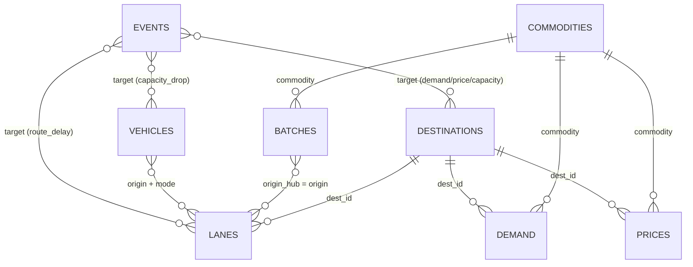

# DATABASE.md

**FreshRoute — data model.** Every table, column, key, unit, rule, and output file the system reads or writes.

> Companion to `ARCHITECTURE.md` (behaviour), `TODO.md` (schedule), `CONTRIBUTING.md` (workflow).
> **Rule #1: if the organizers publish a cost model or dataset format, theirs overrides this schema.** Fill in §8 (mapping template) at H0 and adapt `adapters/organizer.py`; this schema exists so every policy and baseline is scored identically and so we can practise before the real data arrives.
> **Changing any column, file name, or JSON field in this document is a contract change** — see `CONTRIBUTING.md` §7.

---

## 1. Storage approach

- **No database server.** CSV files are the tables; pandas holds them in memory. JSON holds run-level documents.
- Why: reproducible, diffable in git, trivial to swap in hidden scenarios, zero setup on the demo laptop.
- **Source of truth for inputs:** `data/scenarios/<name>/*.csv` + `scenario.json` (or organizer files converted by the adapter).
- **Source of truth for results:** `outputs/<run_id>/` (never edited by hand; the API serves it and the UI only reads it). The API's own bookkeeping lives in `outputs/.api/` and is never a source of truth (D-18, D-21).
- `schema_version` (integer, currently **1**) is stored in `scenario.json` and `run_manifest.json`. Bump it on any contract change.

---

## 2. Conventions (apply everywhere)

| Topic | Rule |
|---|---|
| Files | UTF-8, comma-separated, header row, `\n` line endings, no index column, no quoting unless needed |
| Time | Hours from the planning epoch `t = 0`; `day(h) = floor(h / 24)`; days are 0-based integers. Epoch = 00:00 of day 0 (assumption A-01) |
| Units | mass **kg** · money **₹** · price **₹/kg** · temperature **°C** · time **h** |
| Percent columns | Columns/fields ending `_pct` hold **0–100** in files and JSON. `io.py` converts to fractions (`*_frac`, 0–1) on load — the **only** place that conversion happens |
| Fractions | Fields ending `_frac` hold 0–1 |
| Naming | `snake_case`; suffixes carry units: `_kg`, `_h`, `_inr`, `_inr_kg`, `_c`, `_pct`, `_frac`, `_day` |
| IDs | Non-empty strings, case-sensitive, no spaces recommended; PKs unique within their table |
| Booleans | `true` / `false` in JSON; `True`/`False` or `1`/`0` accepted in CSV on load, written as `true`/`false` |
| Missing values | Not allowed in required columns (load error). Optional columns are blank |
| Floats | Written with enough precision to round-trip (`repr`); money rounded only for display |
| Quantiles | Where a table has `p10/p50/p90`, they must satisfy `p10 ≤ p50 ≤ p90` |
| Prices from Agmarknet | Modal/min/max are ₹ per **quintal**; **÷ 100 → ₹/kg** (1 quintal = 100 kg) |

---

## 3. Input tables

### 3.1 `commodities` — PK `commodity`

| Column | Type | Unit | Rule | Notes |
|---|---|---|---|---|
| `commodity` | str | – | PK, lower_snake | e.g. `tomato` |
| `perishability_class` | enum | – | `very_high` / `high` / `low` | FAO-style tiers |
| `base_shelf_life_h` | float | h | > 0 | Ambient, **de-rated** team assumption (A-15); generator uses it to draw batch RSLs |
| `ref_temp_c` | float | °C | – | Temperature at which 1 h consumes 1 h of life |
| `q10` | float | – | > 0 (typically ≥ 1) | Decay multiplier per +10 °C; default 2 |
| `min_sell_window_h` | float | h | ≥ 0 | Minimum usable life required at arrival |
| `handling_loss_pct` | float | % | 0–100 | Share of delivered kg lost in transit/handling |
| `unit_cost_inr_kg` | float | ₹/kg | ≥ 0 | Procurement/landed cost used in spoilage cost |
| `disposal_cost_inr_kg` | float | ₹/kg | ≥ 0 | |
| `salvage_value_inr_kg` | float | ₹/kg | ≥ 0 | Recovered value of spoiled kg; also the markdown price floor |
| `price_elasticity` | float | uplift per unit discount fraction | ≥ 0 | ε: `effective_demand = demand·(1 + min(ε·discount, MAX_UPLIFT))` |
| `max_discount_pct` | float | % | 0–100 | Per-commodity markdown cap |

Practice-data starting points (team assumptions, disclose in README): commodity mix **tomato, spinach/leafy greens, banana, mango, onion, potato** to span FAO's perishability classes — `very_high` (spinach, ripe tomato), `high` (banana, mango), `low` (onion, potato). Ambient base shelf life: tomato ≈ 4–7 days (96–168 h), spinach ≈ 2–3 days (48–72 h), banana ≈ 5–8 days (120–192 h), onion 30+ days (≥ 720 h). Mango and potato values: team to set and disclose. These are de-rated from temperate cold-storage references (FAO, UMaine) and are **not** measured Indian ambient-chain data.

### 3.2 `batches` — PK `batch_id`

| Column | Type | Unit | Rule | Notes |
|---|---|---|---|---|
| `batch_id` | str | – | PK | |
| `commodity` | str | – | FK → `commodities.commodity` | |
| `origin_hub` | str | – | must appear in `lanes.origin` (else warning) | |
| `qty_kg` | float | kg | > 0 | |
| `remaining_shelf_life_h` | float | h | ≥ 0 | **P50** RSL at `available_from_h`, in reference-temperature-equivalent hours (A-03). `0` allowed (edge case: already expired) |
| `rsl_p10_h` | float | h | ≥ 0, `≤ remaining_shelf_life_h` | Used by stress test |
| `rsl_p90_h` | float | h | `≥ remaining_shelf_life_h` | Used by stress test |
| `storage_temp_c` | float | °C | – | Origin storage temperature (decay while waiting) |
| `quality_grade` | str | – | optional | Informational only unless the organizers define a use |
| `available_from_h` | float | h | ≥ 0 | |

### 3.3 `destinations` — PK `dest_id`

| Column | Type | Unit | Rule | Notes |
|---|---|---|---|---|
| `dest_id` | str | – | PK | |
| `name` | str | – | non-empty | Display name |
| `type` | enum | – | `mandi` / `retail_DC` / `HoReCa` / `processor` | |
| `receive_cap_kg_day` | float | kg/day | ≥ 0 | Total receiving capacity per **arrival** day (all commodities) |
| `handling_time_h` | float | h | ≥ 0 | Subtracted from usable life |
| `handling_cost_inr_kg` | float | ₹/kg | ≥ 0 | Applied to delivered kg |
| `window_open_h` | float | h | `< window_close_h` | Meaning depends on `scenario.json: window_mode` (below) |
| `window_close_h` | float | h | | |

`window_mode = absolute`: window is `[open, close]` in hours from epoch. `window_mode = daily`: `open/close` are hours-of-day in `[0, 24]` repeating every day (windows crossing midnight are not supported; split or adapt). Default `absolute` (A-01) — **confirm with the organizers**.

### 3.4 `demand` — PK `(dest_id, commodity, day)`

| Column | Type | Unit | Rule | Notes |
|---|---|---|---|---|
| `dest_id` | str | – | FK → `destinations` | |
| `commodity` | str | – | FK → `commodities` | |
| `day` | int | day | ≥ 0 | |
| `demand_kg_p50` | float | kg | ≥ 0 | Base (undiscounted) demand used for planning and the base realization |
| `demand_kg_p10` | float | kg | ≥ 0, `≤ p50` | |
| `demand_kg_p90` | float | kg | `≥ p50` | |
| `event_flag` | str | – | blank = none | Free-text/`event_id` marker for event-affected days |

A missing `(dest, commodity, day)` row means demand 0 (counted and reported as a warning).

### 3.5 `prices` — PK `(dest_id, commodity, day)`

| Column | Type | Unit | Rule | Notes |
|---|---|---|---|---|
| `dest_id` | str | – | FK | |
| `commodity` | str | – | FK | |
| `day` | int | day | ≥ 0 | |
| `price_inr_kg` | float | ₹/kg | > 0, `price_min ≤ price ≤ price_max` | Modal price (Agmarknet modal ÷ 100 for practice data) |
| `price_min` | float | ₹/kg | > 0 | |
| `price_max` | float | ₹/kg | > 0 | |

Every `(dest, commodity, day)` with `demand_kg_p50 > 0` needs a price. If missing: forward-fill from the previous day for that pair (warning); if no earlier day exists → **load error**.

### 3.6 `lanes` — PK `(origin, dest_id, mode)`

| Column | Type | Unit | Rule | Notes |
|---|---|---|---|---|
| `origin` | str | – | | Origin hub id (matches `batches.origin_hub`, `vehicles.origin`) |
| `dest_id` | str | – | FK → `destinations` | |
| `mode` | enum | – | `reefer` / `ambient` / `rail` | |
| `travel_h_p50` | float | h | > 0 | Used for planning |
| `travel_h_p90` | float | h | `≥ travel_h_p50` | Used by stress test |
| `cost_fixed_inr_trip` | float | ₹/trip | ≥ 0 | |
| `cost_var_inr_kg` | float | ₹/kg | ≥ 0 | |
| `transit_temp_c` | float | °C | – | Drives transit decay |
| `departure_slots` | str | hour-of-day | `rail` only: pipe-separated hours in `[0, 24)`, e.g. `18\|22`; blank otherwise | Rail is a slower, cheaper lane with fixed departure slots |

### 3.7 `vehicles` — PK `vehicle_id`

| Column | Type | Unit | Rule | Notes |
|---|---|---|---|---|
| `vehicle_id` | str | – | PK | One physical vehicle |
| `origin` | str | – | | |
| `mode` | enum | – | `reefer` / `ambient` / `rail` | Must match a lane mode from the same origin (else warning) |
| `capacity_kg` | float | kg | > 0 | |
| `available_from_h` | float | h | ≥ 0 | |
| `max_trips_day` | int | trips/day | ≥ 0 | `0` allowed (edge case: zero capacity) |

### 3.8 `events` — PK `event_id` (hidden-scenario practice; schema in §6)

| Column | Type | Rule |
|---|---|---|
| `event_id` | str | PK |
| `type` | enum | `route_delay` / `capacity_drop` / `demand_spike` / `new_order` / `price_shock` |
| `target` | str | syntax per type (§6) |
| `magnitude` | float | range per type (§6) |
| `at_h` | float | ≥ 0 |

### 3.9 `geo` — optional, **UI only** (PK `node_id`)

Our addition for the shelf-life countdown map. The optimizer never reads it. If absent, the UI falls back to a colour-coded table. The map reads it through `GET /api/scenarios/{name}/geo` (§11).

| Column | Type | Rule |
|---|---|---|
| `node_id` | str | PK; a hub id or a `dest_id` |
| `node_type` | enum | `hub` / `destination` |
| `name` | str | |
| `lat` | float | −90…90 |
| `lon` | float | −180…180 |

### 3.10 `scenario.json`

```json
{
  "schema_version": 1,
  "name": "practice_01",
  "source": "synthetic",
  "seed": 42,
  "horizon_days": 3,
  "window_mode": "absolute",
  "dispatch_hour": 5,
  "price_source": "static_table_generator_v1",
  "notes": "free text"
}
```
`source` is `synthetic` or `organizer`. `price_source` is optional and informational (e.g. `static_table_generator_v1` or `agmarknet_snapshot`); the loader ignores it. `dispatch_hour` overrides `config.DISPATCH_HOUR`. `horizon_days` bounds `demand.day`, `prices.day`, dispatch days and arrival days.

---

## 4. Derived tables (in memory; written to `outputs/` when useful)

### 4.1 `arcs` — one row per candidate `(batch, dest, vehicle, dispatch day)` (built by `feasibility.py`)

| Column | Type | Notes |
|---|---|---|
| `batch_id`, `dest_id`, `vehicle_id` | str | |
| `mode` | enum | lane/vehicle mode |
| `dispatch_day` | int | `t` |
| `dispatch_h` | float | `max(24t + DISPATCH_HOUR, available_from_h(batch), available_from_h(vehicle))`, moved to the next slot for rail |
| `arrival_h`, `arrival_day` | float, int | `dispatch_h + travel_h_p50` |
| `usable_life_at_arrival_h` | float | ARCHITECTURE §7 |
| `slack_h` | float | `usable_life_at_arrival_h − min_sell_window_h` (negative ⇒ infeasible by shelf life) |
| `price_inr_kg` | float | price at `(dest, commodity, arrival_day)` |
| `margin_inr_kg` | float | `p·(1 − h_c) − cost_var − handling_cost_inr_kg` (before fixed trip cost) |
| `feasible` | bool | |
| `reject_reason` | enum | blank if feasible; else `NO_LANE`, `NOT_AVAILABLE`, `RAIL_SLOT`, `WINDOW`, `SHELF_LIFE`, `BEYOND_HORIZON` (first failing check in that order) |

Rejected rows are kept: reason cards read them.

### 4.2 `demand_target` — one row per `(dest_id, commodity, day)` (newsvendor)

`dest_id, commodity, day, target_kg, quantile_used, c_u, c_o`. When the newsvendor flag is off, `target_kg = demand_kg_p50`.

---

## 5. Output files (`outputs/<run_id>/`)

`run_id` = `<scenario>__<policy>__s<seed>[__nv]` — the `__nv` suffix is added only when `--newsvendor` is on (stable and human-readable; no timestamps in the id).

### 5.1 `run_manifest.json`

```json
{
  "schema_version": 1,
  "run_id": "practice_01__milp_markdown__s42",
  "git_sha": "…",
  "scenario": "data/scenarios/practice_01",
  "scenario_sha256": "…",
  "policy": "milp_markdown",
  "flags": {"markdown": true, "newsvendor": false},
  "seed": 42,
  "realization": "base",
  "package_versions": {"python": "…", "scipy": "…", "pulp": "…", "highspy": "…", "pandas": "…"},
  "solver": {"status": "optimal", "mip_gap": 0.0, "solve_seconds": 0.0, "fallback_used": false, "slack_usage": {}},
  "timestamp_utc": "…"
}
```
`solver` is `null` for non-MILP policies. Timestamp and `solve_seconds` are the only fields allowed to differ between identical runs.

### 5.2 `plan.csv` — PK `shipment_id` (one row per batch × destination × trip line)

| Column | Type | Notes |
|---|---|---|
| `shipment_id` | str | e.g. `S0001` |
| `batch_id`, `dest_id`, `vehicle_id` | str | |
| `trip_id` | str | FK → `trips.trip_id` |
| `mode` | enum | |
| `dispatch_day` | int | |
| `dispatch_h`, `arrival_h` | float | |
| `arrival_day` | int | |
| `kg` | float | > 0 |
| `usable_life_at_arrival_h` | float | |
| `slack_h` | float | |
| `margin_inr_kg` | float | |
| `priority_rank` | int | 1 = dispatch first |
| `priority_score` | float | `(1 / usable_life_at_arrival_h) · (kg · price)` |
| `is_frozen` | bool | `true` only in replanned plans (already dispatched at `at_h`) |
| `policy` | str | which policy produced the row |

### 5.3 `trips.csv` — PK `trip_id`

`trip_id` (`T-<vehicle>-<dest>-<day>-<k>`), `vehicle_id`, `origin`, `dest_id`, `mode`, `dispatch_day`, `dispatch_h`, `kg_total`, `capacity_kg`, `utilization_pct`, `cost_fixed_inr`, `cost_var_inr`.
Loads are assigned to trips by deterministic first-fit in priority order; one batch line may split across trips. `Σ_trip kg_total ≤ capacity_kg`.

### 5.4 `discounts.csv` — PK `(lot_id, day)`

| Column | Type | Notes |
|---|---|---|
| `lot_id` | str | `<batch_id>@<dest_id>@<arrival_day>` |
| `dest_id`, `commodity`, `batch_id` | str | |
| `day` | int | |
| `stock_kg` | float | stock the risk was computed on |
| `risk` | float | 0–1 |
| `tier_base_pct` | float | tier from risk |
| `tier_after_time_trigger_pct` | float | after the ≤ 24 h step-up |
| `discount_pct` | float | final after caps, worth-it test and monotonicity |
| `capped_by` | enum | `none` / `max_discount` / `salvage_floor` |
| `applied` | bool | `false` if the worth-it test removed the discount |
| `forced_by_monotone` | bool | |
| `delta_revenue_inr` | float | the worth-it test value |

### 5.5 `unshipped.csv` — PK `batch_id`

`batch_id, kg_unshipped, origin_expiry_h, outcome` where `outcome ∈ {expired_at_origin, carryover}`.

### 5.6 `sim_ledger.csv` (PK `(dest_id, commodity, day)`) and `sim_lots.csv` (PK `lot_id`)

`sim_ledger.csv`: `dest_id, commodity, day, base_demand_kg, effective_demand_kg, delivered_kg, handling_loss_kg, sold_kg, price_inr_kg, discount_frac, unsold_expired_kg, on_hand_end_kg, carryover_kg`. (`discount_frac` is 0–1 in memory and in this file; money columns are not stored here — `metrics.json` derives revenue from `sold_kg`, `price_inr_kg` and `discount_frac` via `costmodel.py`.)
`sim_lots.csv`: `lot_id, dest_id, commodity, arrival_h, arrival_day, expiry_h, kg_arrived, kg_handling_loss, kg_sold, kg_expired_unsold, kg_carryover`.

### 5.7 `metrics.json`

Structure (values here are placeholders):

```json
{
  "schema_version": 1,
  "run_id": "…", "scenario": "…", "policy": "…", "seed": 42, "realization": "base",
  "kpis": {
    "spoilage_kg": 0.0, "spoilage_pct": 0.0,
    "demand_fulfillment_pct": 0.0, "min_dest_fill_pct": 0.0,
    "net_inr": 0.0, "violations": 0
  },
  "spoilage_breakdown_kg": {"handling_loss": 0.0, "delivered_unsold_expired": 0.0, "origin_expired": 0.0},
  "economics_inr": {
    "gross_revenue_at_list": 0.0, "discount_cost": 0.0, "revenue": 0.0,
    "transport": 0.0, "handling": 0.0, "spoilage_cost": 0.0, "net": 0.0
  },
  "volumes_kg": {
    "total_supply": 0.0, "shipped": 0.0, "unshipped": 0.0, "sold": 0.0,
    "carryover": {"destination": 0.0, "origin": 0.0, "total": 0.0}
  },
  "trips": {"count": 0, "avg_utilization_pct": 0.0},
  "per_destination": [{"dest_id": "…", "fill_pct": 0.0, "sold_kg": 0.0, "spoiled_kg": 0.0}],
  "per_commodity": [{"commodity": "…", "spoilage_kg": 0.0, "spoilage_pct": 0.0, "sold_kg": 0.0}]
}
```

**Invariants (unit-tested on every policy):**
1. `revenue = gross_revenue_at_list − discount_cost`
2. `net = revenue − transport − handling − spoilage_cost`, and `kpis.net_inr == economics_inr.net`
3. `spoilage_kg = handling_loss + delivered_unsold_expired + origin_expired`
4. **Mass balance:** `total_supply = sold + spoilage_kg + carryover.total`
5. `total_supply = shipped + unshipped`
6. `spoilage_pct = spoilage_kg / total_supply × 100`

### 5.8 `validation.json`

```json
{
  "schema_version": 1,
  "violation_total": 0,
  "counts": {"SHELF_LIFE": 0},
  "violations": [{"code": "SHELF_LIFE", "shipment_id": "S0007", "detail": "…", "observed": 13.0, "limit": 24.0}],
  "warnings": [{"code": "DEMAND_CAP_EXCEEDED", "detail": "…"}]
}
```
Violation and warning code lists: ARCHITECTURE §11. `kpis.violations == violation_total`.

### 5.9 `reason_cards.json` — list, one card per `shipment_id`

```json
{
  "shipment_id": "S0007", "batch_id": "B014", "commodity": "tomato",
  "chosen": {"dest_id": "PUNE", "vehicle_id": "V03", "mode": "reefer", "dispatch_h": 5.0, "arrival_h": 17.0,
             "usable_life_at_arrival_h": 41.0, "slack_h": 17.0, "margin_inr_kg": 0.0},
  "priority": {"rank": 3, "score": 0.0},
  "alternatives": [{"dest_id": "DELHI", "mode": "ambient", "dispatch_day": 0, "feasible": false,
                    "reject_reason": "SHELF_LIFE", "usable_life_at_arrival_h": 9.0, "margin_inr_kg": 0.0,
                    "reason_code": "SHELF_LIFE"}],
  "discount": {"day": 2, "risk": 0.38, "tier_pct": 20, "capped_by": "none"},
  "text": "Sent to Pune, not Delhi: …"
}
```
`alternatives[].reason_code ∈ {SHELF_LIFE, WINDOW, CAPACITY_BOUND, DEMAND_CAP, LOWER_MARGIN}`. `discount` is `null` when none applies. Numbers above are format examples only.

### 5.10 Dispatch sheet — `dispatch_sheet.csv` and `dispatch_sheet.txt`

CSV columns: `vehicle_id, trip_id, dispatch_h, depart_clock, dest_id, dest_name, batch_id, commodity, kg, priority_rank, slack_h, arrive_by_h, note`. Rows ordered by `priority_rank`.
Text (one block per trip, WhatsApp-style, plain text):

```
Vehicle V03 | Trip T-V03-PUNE-0-1 | Depart 05:00 (day 0)
To: Pune DC
Load: B014 tomato 420 kg (slack 17 h) | B009 tomato 180 kg (slack 22 h)
Arrive by: day 0 17:00
```

### 5.11 `ladder.json` and `waterfall.json`

`ladder.json`:
```json
{"scenario": "…", "seed": 42, "realization": "base",
 "official_baseline": {"policy": "organizer_baseline", "kpis": {}},
 "ladder": [{"policy": "fifo", "kpis": {}}, {"policy": "fefo", "kpis": {}},
            {"policy": "milp", "kpis": {}}, {"policy": "milp_markdown", "kpis": {}}],
 "extras": [{"policy": "last_day_50", "kpis": {}}]}
```
`kpis` has the same keys as `metrics.json → kpis`.

`waterfall.json`:
```json
{"baseline": "organizer_baseline", "plan": "milp_markdown", "tolerance_inr": 0.01,
 "steps": [
  {"label": "Baseline net", "value": 0.0, "type": "total"},
  {"label": "Spoilage cost avoided", "value": 0.0, "type": "delta"},
  {"label": "Extra sales (list price)", "value": 0.0, "type": "delta"},
  {"label": "Extra transport", "value": 0.0, "type": "delta"},
  {"label": "Extra handling", "value": 0.0, "type": "delta"},
  {"label": "Discounts given", "value": 0.0, "type": "delta"},
  {"label": "FreshRoute net", "value": 0.0, "type": "total"}]}
```
Step formulas: `ARCHITECTURE.md` §12. Signs: cost steps are negative when the plan spends more. Invariant: `first total + Σ deltas = last total` within tolerance.

**Until C-06 lands (no organizer baseline doc yet):** `ladder.json → official_baseline` is `null` and `waterfall.json → baseline` is `"fefo"`. Both switch to `organizer_baseline` once C-06 is implemented. Written by `freshroute ladder` to `outputs/<scenario>__ladder__s<seed>/`; each ladder policy also gets its normal `outputs/<run_id>/`.

### 5.12 Stress and sensitivity

- `stress.csv` — one row per scenario `i` per policy: `scenario_i, policy, spoilage_kg, spoilage_pct, demand_fulfillment_pct, min_dest_fill_pct, net_inr`.
- `stress_summary.json`:
```json
{"n": 200, "base_seed": 42, "plan": "milp_markdown", "baseline": "organizer_baseline",
 "bands": {"net_inr": {"plan": {"p10": 0, "p50": 0, "p90": 0}, "baseline": {"p10": 0, "p50": 0, "p90": 0}},
           "spoilage_kg": {"plan": {}, "baseline": {}},
           "demand_fulfillment_pct": {"plan": {}, "baseline": {}}},
 "share_plan_beats_baseline": {"net_inr": 0.0, "spoilage_kg": 0.0}}
```
`share_plan_beats_baseline` is in 0–1 over **paired** scenarios.
- `sensitivity.csv` — `parameter, value, policy, net_inr, spoilage_kg, demand_fulfillment_pct`. Parameters: `q10`, `elasticity_multiplier` (1, 0.5), `overship_slack`, `demand_multiplier` (0.8, 1.0, 1.2).

### 5.13 Replan outputs — `replan/<event_id>/`

- `event.json` (§6) · `plan.csv`, `trips.csv`, `discounts.csv`, `metrics.json`, `validation.json` (same formats as above; `plan.csv` has `is_frozen`).
- `diff.json`:
```json
{"event_id": "E-001", "at_h": 8.0,
 "frozen_shipments": 0, "moved_batches": [{"batch_id": "B014", "from": {"dest_id": "DELHI", "dispatch_day": 0},
                                           "to": {"dest_id": "PUNE", "dispatch_day": 0}, "kg": 0.0}],
 "discount_changes": [{"lot_id": "…", "day": 2, "from_pct": 10, "to_pct": 20}],
 "kpis_old_plan_under_event": {}, "kpis_replanned": {}, "delta_kpis": {},
 "solve_seconds": 0.0}
```
`kpis_old_plan_under_event` = the old plan executed in the changed world (the honest do-nothing comparison).

### 5.14 Directory layouts

```
data/scenarios/<name>/        commodities.csv batches.csv destinations.csv demand.csv prices.csv
                              lanes.csv vehicles.csv events.csv [geo.csv] scenario.json
outputs/<run_id>/             run_manifest.json plan.csv trips.csv discounts.csv unshipped.csv
                              sim_ledger.csv sim_lots.csv metrics.json validation.json
                              reason_cards.json dispatch_sheet.csv dispatch_sheet.txt
                              [ladder.json waterfall.json stress.csv stress_summary.json sensitivity.csv]
                              [replan/<event_id>/…]
outputs/.api/jobs/              API run-queue state only (§11); gitignored with the rest of outputs/
outputs/demo_backup/            committed copy of the demo run (fallback if the solver fails on demo day)
```

Run-directory contents are unchanged by the API refactor, so `schema_version` stays **1**; the HTTP layer has its own `api_version` (§11).

---

## 6. Event schema (replan and the optional LLM parser)

```json
{"event_id": "E-001", "type": "route_delay", "target": "NASHIK|PUNE|*", "magnitude": 6, "at_h": 8, "note": "NH-48 jam"}
```
Validated with pydantic (`events.py`). `note` is optional and never used by the solver. **Semantics are our interpretation (A-14) — confirm against the organizers' event definitions.**

| `type` | `target` syntax | `magnitude` | Effect |
|---|---|---|---|
| `route_delay` | lane key `origin\|dest_id\|mode`; `*` allowed in any position | hours ≥ 0 | Adds `magnitude` to `travel_h_p50` and `travel_h_p90` of matching lanes; affects not-yet-dispatched **and** in-transit trips whose `arrival_h > at_h` |
| `capacity_drop` | `vehicle:<vehicle_id>` or `dest:<dest_id>` | fraction lost, 0–1 | Multiplies `capacity_kg` (vehicle) or `receive_cap_kg_day` (destination) by `1 − magnitude` from `at_h` |
| `demand_spike` | `dest:<dest_id>\|<commodity>`; `*` allowed for commodity | multiplier > 0 | Multiplies p10/p50/p90 demand for days `≥ day(at_h)` |
| `new_order` | `dest:<dest_id>\|<commodity>` | extra kg ≥ 0 | Adds `magnitude` kg to p10/p50/p90 demand on `day(at_h)` |
| `price_shock` | `dest:<dest_id>\|<commodity>`; `*` allowed for commodity | multiplier > 0 | Multiplies `price_inr_kg/min/max` for days `≥ day(at_h)` |

Freeze rule: a shipment is frozen iff `dispatch_h ≤ at_h`. Frozen shipments consume stock, trips, receiving capacity and demand, but cannot be reassigned.

Canned events for the dropdown (one per type; adjust ids to the scenario): NH-48 jam (`route_delay`, +6 h on all lanes into one destination), a reefer breakdown (`capacity_drop` 0.5 on one reefer), a demand spike ×1.5 at one destination for one commodity, a `new_order` of a few hundred kg, and a `price_shock` ×0.8.

---

## 7. Load-time integrity checks (`io.load_scenario`)

**Errors (stop):** missing table or required column; NaN/blank in a required field; duplicate PK; unknown enum value; FK violation (`batches.commodity`, `demand`/`prices` `dest_id` and `commodity`, `lanes.dest_id`); numeric range violations (§3); quantile ordering violation (`p10 ≤ p50 ≤ p90`, `travel p50 ≤ p90`, RSL ordering); `window_open_h ≥ window_close_h`; `rail` lane without `departure_slots`; `demand.day` or `prices.day` negative; a price needed for `demand_kg_p50 > 0` but none available even after forward-fill.

**Warnings (continue, count and print):** batch `origin_hub` with no lane; vehicle `(origin, mode)` with no matching lane; non-rail lane with `departure_slots`; missing demand rows (treated as 0); forward-filled prices; `salvage_value_inr_kg > unit_cost_inr_kg + disposal_cost_inr_kg` (negative spoilage cost); `max_discount_pct > 0` with `price_elasticity = 0`; `available_from_h ≥ 24 · horizon_days`; `demand.day ≥ horizon_days`; `scenario.source = synthetic` (printed on every scoreboard so synthetic numbers are never mistaken for real ones).

**Conversions (once, here):** `handling_loss_pct → handling_loss_frac`, `max_discount_pct → max_discount_frac`. Tests: 2.5 in CSV ⇒ 0.025 in memory ⇒ 2.5 back in outputs.

---

## 8. Organizer mapping template (fill at H0 — `TODO.md` S-02)

Copy this table into the README and complete it. "Status": `OK` mapped · `XFORM` needs a transform · `MISSING` no equivalent (decide + log an assumption) · `N/A`.

| Our table.column | Organizer file.column | Transform | Status |
|---|---|---|---|
| `batches.*` (qty, RSL, temp, availability, origin) | | | |
| `commodities.base_shelf_life_h / ref_temp_c / q10` | | | |
| `commodities.min_sell_window_h` | | | |
| `commodities.handling_loss_pct` | | | |
| `commodities.unit_cost / disposal_cost / salvage_value` | | | |
| `commodities.price_elasticity / max_discount_pct` | | | |
| `destinations.receive_cap_kg_day` | | | |
| `destinations.handling_time_h / handling_cost_inr_kg` | | | |
| `destinations.window_open_h / window_close_h` (+ `window_mode`) | | | |
| `demand.demand_kg_p10/p50/p90` | | | |
| `prices.*` | | | |
| `lanes.travel_h_p50/p90` | | | |
| `lanes.cost_fixed_inr_trip / cost_var_inr_kg` | | | |
| `lanes.transit_temp_c` | | | |
| `lanes.departure_slots` (rail) | | | |
| `vehicles.*` (capacity, trips/day, availability) | | | |
| `events.*` | | | |
| Origin handling cost (we assume 0 — A-07) | | | |
| Discount / markdown rules (tiers, caps, elasticity) | | | |
| Spoilage definition and cost | | | |
| Fulfillment definition | | | |
| Hard-constraint list (what counts as a violation) | | | |
| Submission/plan output format (for `organizer_baseline` export) | | | |

---

## 9. Agmarknet snapshot (calibration data for practice scenarios)

- **Source:** "Variety-wise Daily Market Prices Data of Commodity" on data.gov.in (Agmarknet via the OGD platform). Fields: state, district, market, commodity, variety, grade, min/max/modal price (₹ per quintal).
- **Snapshot file:** `data/agmarknet/agmarknet_snapshot.csv` with columns `state, district, market, commodity, variety, arrival_date, min_price, max_price, modal_price` (₹/quintal as published).
- **Access requires a registered API key.** Resource ids: `35985678-0d79-46b4-9ed6-6f13308a1d24` (current, filters are PascalCase: `filters[Arrival_Date]`, `filters[State]`) and `9ef84268-d588-465a-a308-a864a43d0070` (original, lowercase filters: `filters[arrival_date]`, `filters[state]`). The widely circulated sample key returns `{"error": "Key not authorised"}` — **do not ship one in git.** Put the key in `.env` as `DATAGOV_API_KEY` (git-ignored) and page with `limit=500&offset=…`.
- **Status 2026-10-14 (PRE-02):** no snapshot. No key is available to the team, so PRE-02 was closed on its own fallback: the generator's static price table (`scenario.json → price_source = static_table_generator_v1`, A-30). A-20 therefore does not apply to our practice data.
- **The transform below is specified but not implemented:** `scripts/build_prices.py` does not exist yet (`scripts/` is empty). Whoever obtains a key writes it, then re-opens A-20.
- **Transform** (`scripts/build_prices.py`): `price_inr_kg = modal_price / 100`, `price_min = min_price / 100`, `price_max = max_price / 100`; map markets to `dest_id` by hand; map commodity names by hand (check spelling in the snapshot); replay the most recent `horizon_days` days as day `0…H−1`.
- Context only: post-harvest-loss statistics (NABCONS/PIB) are used to sanity-check the synthetic baseline (A-21), never as model inputs presented as real batch data.

---

## 10. Relationships



Text form: `batches.commodity → commodities` · `demand.(dest_id, commodity) → destinations, commodities` · `prices.(dest_id, commodity) → destinations, commodities` · `lanes.dest_id → destinations` · `batches.origin_hub = lanes.origin = vehicles.origin` (soft link, hubs have no table) · `vehicles.mode = lanes.mode` (soft link) · `events.target` references lanes / vehicles / destinations by the syntax in §6 · `plan.batch_id → batches` · `plan.dest_id → destinations` · `plan.vehicle_id → vehicles` · `plan.trip_id → trips` · `discounts.lot_id` derived from plan.

Hubs are identified only by the string used in `batches.origin_hub`, `lanes.origin`, `vehicles.origin`; `geo.csv` (optional) gives them coordinates.

---

## 11. HTTP API (`/api`, FastAPI)

The dashboard's only door to the engine. The API **serves run artifacts verbatim** and **enqueues engine runs**; it never computes a KPI (ARCHITECTURE §16, D-18). Contract version: `api_version = 1`; changing an endpoint shape bumps it and updates `frontend/src/types.ts` in the same change.

### 11.1 Rules

- **Verbatim by default.** A field in a response is the field in the file. The API adds at most three wrappers: `baseline` (the ladder/fefo comparison), `validation` and `manifest` (companion files of the same run), and `fixture` (the placeholder flag when nothing is on disk).
- **Nothing is computed.** No KPI, no delta, no average, no aggregation over tables. If a number is not in a file, it is not in the response.
- **Never a 500 from bad data.** A scenario that fails to load is a `400` with `{"detail": "..."}`; a run that fails is a job in state `error`, not an exception.
- **Loopback, no auth.** Binds `API_HOST`/`API_PORT` (§19 of `ARCHITECTURE.md`); CORS is dev-only.

### 11.2 Endpoints

| Method + path | Success | Body |
|---|---|---|
| `GET /api/health` | 200 | `{"status": "ok", "schema_version": 1, "api_version": 1}` |
| `GET /api/scenarios` | 200 | `[{"name", "source", "horizon_days", "window_mode"}]` — from `data/scenarios/*/scenario.json`, sorted by `name` |
| `GET /api/scenarios/{name}/geo` | 200 / 404 | `geo.csv` as records (§3.9), or 404 when absent (the UI uses the colour table) |
| `GET /api/runs` | 200 | `{"runs": [{"run_id", "scenario", "policy", "seed", "has_ladder"}], "fixture": false}` — `run_id`s from `outputs/*/metrics.json`, sorted; `fixture: true` when the list is empty and `backend/tests/fixtures/metrics_example.json` is being served |
| `GET /api/runs/{run_id}` | 200 / 404 | `metrics.json` verbatim, plus `baseline` (see `data_access.load_baseline` ordering: ladder `official_baseline` → ladder `fefo` → sibling `fefo` run), `validation` (`validation.json` or `null`), `manifest` (`run_manifest.json` or `null`) |
| `GET /api/runs/{run_id}/tables/{table}` | 200 / 404 | `table ∈ {plan, trips, discounts, sim_ledger, sim_lots}` (§5.2–§5.6) as `{"columns": [...], "records": [...]}`; `?format=csv` returns the file as `text/csv` for download |
| `GET /api/runs/{run_id}/reason-cards` | 200 | `reason_cards.json` (§5.9), or `null` when the run has none yet (nothing writes them before U-01) |
| `GET /api/runs/{run_id}/dispatch-sheet` | 200 | `{"csv": [...records...], "text": "..."}` (§5.10), or `null` when absent |
| `GET /api/ladder?scenario=&seed=` | 200 / 404 | `{"ladder": …, "waterfall": …}` from §5.11, or 404 when not on disk |
| `POST /api/runs` | 202 | Request `{"scenario": "data/scenarios/practice", "policy": "milp_markdown", "seed": 42, "flags": {"markdown": true, "newsvendor": false}}` → `{"run_id": "…__milp_markdown__s42", "status": "running"}`. `policy ∈ ` the CLI's `POLICIES`; an unknown policy or scenario is `400`. `organizer_baseline` is a *recognised* name that cannot run yet (C-06): the API accepts it in the request shape and answers `400` with the same explanation the CLI prints, rather than a bare "unknown policy". |
| `GET /api/runs/{run_id}/status` | 200 / 404 | `{"state": "running" \| "done" \| "error", "started_utc", "finished_utc", "error"}` |

Added later, same shape, only when the CLI command exists: `POST /api/replan` (AD-02), `POST /api/stress` (AD-03), `POST /api/demo` (U-06).

### 11.3 Run-queue state file

`outputs/.api/jobs/<run_id>.json`, written by the API only:

```json
{"api_version": 1, "run_id": "…", "state": "running", "scenario": "…", "policy": "milp_markdown",
 "seed": 42, "started_utc": "…", "finished_utc": null, "error": null}
```

`state` is `running` while the worker thread holds the job, `done` when `outputs/<run_id>/metrics.json` exists, `error` with `error` set otherwise. It is deleted when `outputs/<run_id>/` is deleted. One worker thread (`JOB_WORKERS = 1`), so two solves never run at once on the demo laptop.

### 11.4 Frontend types

`frontend/src/types.ts` mirrors §11.2 field for field. A number shown in the UI must be traceable to a field named in this section or in §3–§5.
